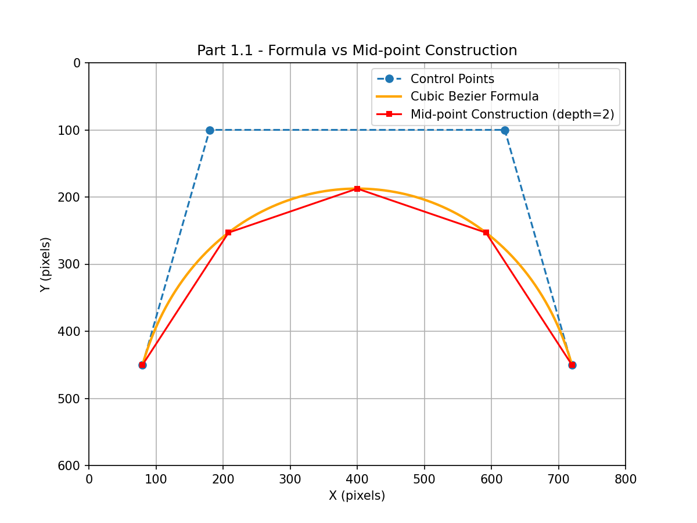
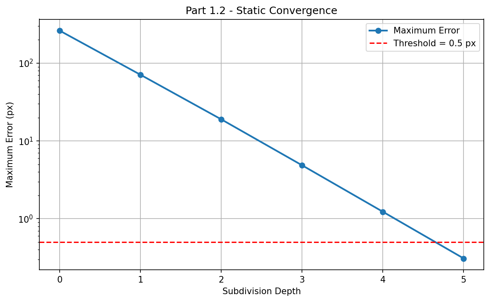
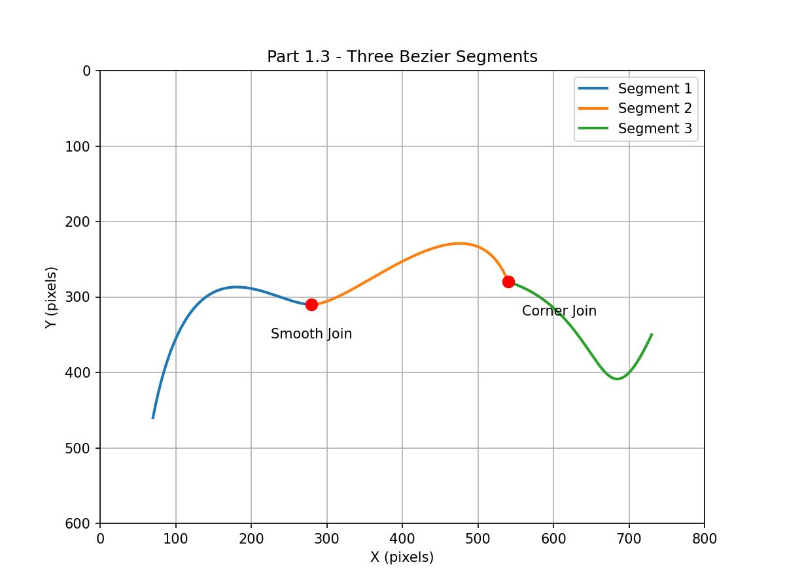
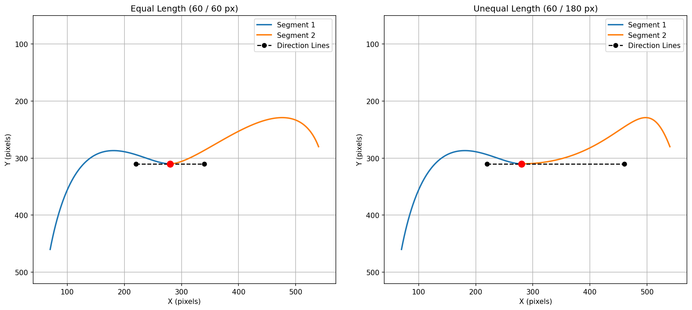

# Interactive Bézier Curve Laboratory

**A reproducible Python laboratory for cubic Bézier construction, midpoint subdivision, approximation-error measurement, and curve continuity.**

This project begins with **static numerical experiments** and extends them into an **interactive Bézier editor**. The geometry is computed by the project's own Python functions; Matplotlib is used to display calculated points, polylines, measurements, and editing controls.

The current milestone covers the three experiments in **Part 1 — *Two Roads to the Same Curve*** of a Multimedia Systems assignment, based on the Bézier curve and smooth-join material in **Chapter 4: Vector Graphics**. The same program is intended to be understandable and reproducible outside the course context.

## Contents

1. [Features and experiments](#features-and-experiments)
2. [Requirements and installation](#requirements-and-installation)
3. [Run the laboratory](#run-the-laboratory)
4. [Experiment 1 — Two constructions of one curve (Part 1.1)](#experiment-1--two-constructions-of-one-curve-part-11)
5. [Experiment 2 — Convergence and error measurement (Part 1.2)](#experiment-2--convergence-and-error-measurement-part-12)
6. [Experiment 3 — Smooth and corner joins (Part 1.3)](#experiment-3--smooth-and-corner-joins-part-13)
7. [Interactive editor guide](#interactive-editor-guide)
8. [Generated files and reproducibility](#generated-files-and-reproducibility)
9. [Coursework checklist and conclusions](#coursework-checklist-and-conclusions)
10. [Implementation boundaries and future work](#implementation-boundaries-and-future-work)

## Features and experiments

| Experiment | Static study | Interactive capability | Evidence |
| --- | --- | --- | --- |
| **1 — Curve construction** | Cubic Bernstein formula versus recursive midpoint construction | Click four control points; drag them; adjust subdivision depth | Overlaid formula curve and subdivision polyline |
| **2 — Convergence** | Measure one-directional maximum point-to-polyline error | Analyze the currently edited curve | Per-depth error, reduction ratios, threshold, PNG/CSV/JSON |
| **3 — Curve joins** | Three connected cubic segments; equal- versus unequal-length handles | Drag join/control points; switch between **C¹** and **G¹** handle constraints | Open-path figure and side-by-side comparison |

The development is organized into two reproducible stages:

- **Stage A — Static experiments:** fixed reference control points provide stable comparisons and numerical baseline results.
- **Stage B — Interactive experiments:** the same algorithms operate on user-selected and user-dragged control points.

Both stages live in **one program, `main.py`**.

## Requirements and installation

### Software and environment

| Component | Requirement / reference environment |
| --- | --- |
| Operating system | Windows 10/11 for the walkthrough; a desktop OS with an available Matplotlib GUI backend is required for interactive use |
| Python | **3.10 or newer** |
| Python package | `matplotlib` (its dependencies are installed by pip) |
| Development tools | VS Code and its Python extension are optional |
| Canvas | **800 × 600 coordinate units**, interpreted as pixels for the error experiment; *y* increases downward |
| Special environment variables | **None required** for normal interactive use |

For reproducibility, the fixed-reference plots and numerical table in this README were regenerated using **CPython 3.13.5** and **Matplotlib 3.10.8** with the noninteractive `Agg` backend. The GUI walkthrough targets a local Windows desktop using Python 3.10+; it must be run with a graphical backend, not `Agg`.

### Windows PowerShell — fresh checkout

Open a terminal in the project directory (the directory containing `main.py`):

```powershell
# 1. Create a virtual environment.
python -m venv .venv

# 2. Activate it in PowerShell.
.\.venv\Scripts\Activate.ps1

# 3. Install the plotting and UI dependency.
python -m pip install --upgrade pip
python -m pip install matplotlib

# 4. Run the program.
python main.py
```

If PowerShell blocks activation, **no policy change is necessary**; call the virtual-environment interpreter directly:

```powershell
.\.venv\Scripts\python.exe -m pip install matplotlib
.\.venv\Scripts\python.exe main.py
```

On macOS or Linux, use `python3 -m venv .venv`, `source .venv/bin/activate`, `python -m pip install matplotlib`, and `python main.py`, with a working desktop display and GUI backend.

### What happens at launch?

1. The program regenerates **four static reference figures** (curve overlay, convergence plot, three-segment open path, and equal/unequal comparison).
2. It prints baseline sampling accuracy and depth-by-depth convergence results in the terminal.
3. It opens the **Interactive Bézier Editor** for direct manipulation of the curve.

The generated files are placed **beside `main.py`**. Running the program again overwrites static figures with the reproducible reference experiment; interactive saves likewise overwrite files with the same output name.

## Experiment 1 — Two constructions of one curve (Part 1.1)

### Goal

Implement **both** cubic Bézier constructions independently and show that they describe the same underlying curve. At a shallow subdivision depth, the endpoint polyline is visibly different from the continuously evaluated formula curve.

### Method A: cubic Bézier formula

For control points $b_0,b_1,b_2,b_3$, implement the cubic Bernstein polynomial directly:

$$
C(t)=(1-t)^3b_0+3t(1-t)^2b_1+3t^2(1-t)b_2+t^3b_3,
\qquad 0\le t\le1.
$$

The program evaluates the *x* and *y* coordinates separately inside `cubic_bezier()`. The endpoints satisfy $C(0)=b_0$ and $C(1)=b_3$; $b_1$ and $b_2$ control the departure and arrival directions.

### Method B: midpoint / de Casteljau subdivision

`split_bezier_half()` performs repeated midpoint interpolation at **$t=0.5$**:

1. First level: $m_{01}=(b_0+b_1)/2$, $m_{12}=(b_1+b_2)/2$, $m_{23}=(b_2+b_3)/2$.
2. Second level: $m_{012}=(m_{01}+m_{12})/2$ and $m_{123}=(m_{12}+m_{23})/2$.
3. Final midpoint: $m=(m_{012}+m_{123})/2$.
4. The two subdivided cubics have control polygons $[b_0,m_{01},m_{012},m]$ and $[m,m_{123},m_{23},b_3]$.

`midpoint_polyline()` recursively applies that split to a specified `depth`, then joins the resulting sub-curve **endpoints** with straight segments. At depth $d$, the approximation contains $2^d$ line segments and $2^d+1$ vertices.

### Reference experiment

The static experiment uses a strongly curved control polygon covering most of the 800 × 600 canvas:

| Control point | x | y |
| --- | ---: | ---: |
| $b_0$ | 80 | 450 |
| $b_1$ | 180 | 100 |
| $b_2$ | 620 | 100 |
| $b_3$ | 720 | 450 |

For the **shallow depth $d=2$**, the four line segments touch the Bézier curve at the endpoints of the four sub-curves, but visibly depart from the orange curve between those points.



**Observation:** The two methods agree on the mathematical curve, but the midpoint **polyline** is only a finite-depth approximation. Increasing the subdivision depth reduces the visible difference without changing the original four control points.

## Experiment 2 — Convergence and error measurement (Part 1.2)

### Goal and required measurement direction

Measure how well the midpoint-generated polyline $L_d$ approximates the formula curve $C$ as subdivision depth $d$ increases.

The required error goes **from sampled points on the formula curve to their nearest *finite line segment*** of the midpoint polyline:

$$
E_d=\max_{p\in C_{\mathrm{sampled}}}\;\min_{s\in L_d}
\mathrm{dist}(p,s).
$$

This is **not** a maximum distance from polyline vertices to the formula curve, nor a nearest-vertex approximation.

For a query point $p$ and segment from $a$ to $b$, `point_to_segment_distance()` computes:

$$
\begin{aligned}
u&=\mathrm{clamp}\!\left(\frac{(p-a)\cdot(b-a)}{\lVert b-a\rVert^2},0,1\right),\\
q&=a+u(b-a),\\
\mathrm{dist}(p,[a,b])&=\lVert p-q\rVert.
\end{aligned}
$$

If $a=b$, the implementation uses the Euclidean distance from $p$ to $a$, avoiding division by zero.

### Sampling precision

To prevent undersampling from dominating the measurement, `sample_formula_curve()`:

1. Samples $C(t)$ on a uniform parameter grid, initially using 2,000 intervals.
2. Measures the largest Euclidean spacing between consecutive formula-curve samples.
3. Doubles the number of intervals until **every consecutive sample spacing is strictly less than 0.1 px**.
4. Uses that refined point set for **every depth** in the same experiment.

For the fixed reference curve, the resulting sample count was **16,001 points**, with maximum spacing **0.068248 px**, satisfying the required criterion.

### Actual measured results

The following values were regenerated by executing the included algorithms with the fixed control points listed in Experiment 1. The last row is the **first depth** satisfying $E_d<0.5$ px.

| Depth $d$ | Polyline segments | Max. error $E_d$ (px) | Reduction factor $E_{d-1}/E_d$ |
| ---: | ---: | ---: | ---: |
| 0 | 1 | 262.500000 | — |
| 1 | 2 | 71.113096 | 3.6913 |
| 2 | 4 | 18.983575 | 3.7460 |
| 3 | 8 | 4.870718 | 3.8975 |
| 4 | 16 | 1.229921 | 3.9602 |
| **5** | **32** | **0.308761** | **3.9834** |

**Threshold conclusion:** the **minimum qualifying subdivision depth is 5** because $E_4=1.229921$ px is not below 0.5 px, whereas $E_5=0.308761$ px is.



### Answers to the convergence questions

**Q1. What rule do the errors follow when depth increases by one?**

The error approaches an approximately **fourfold reduction per level**:

$$
E_{d+1}\approx E_d/4.
$$

This matches the expected behavior of sufficiently fine piecewise-linear approximations to a smooth curve when each subdivision approximately halves the local parameter span.

**Q2. Do shallow depths obey the rule as closely as deeper levels?**

No. The observed reduction factor is **3.6913** from depth 0 to 1, **3.7460** from 1 to 2, and becomes **3.9834** from depth 4 to 5. The deeper levels follow the approximately fourfold pattern more closely.

**Q3. What does midpoint construction enable that a predetermined grid of $t$-samples does not directly provide?**

**Adaptive local refinement:** subdivision produces separate child Bézier curves, allowing an algorithm to subdivide only those portions whose control polygons are insufficiently flat or whose estimated error exceeds a threshold. This avoids having to choose a single uniform sampling density for the whole curve in advance.

**Scope note:** the **implemented** `midpoint_polyline()` uses a uniform recursion depth; adaptive per-segment stopping is an opportunity for future work, **not a feature claimed in this version**.

## Experiment 3 — Smooth and corner joins (Part 1.3)

### Goal: a three-segment open path

Connect three cubic Bézier segments into an **open path** containing exactly two shared joins:

- Join 1 at **(280, 310)** — **smooth**.
- Join 2 at **(540, 280)** — **corner**.

The static segments are:

```text
Segment 1: (70,460) → (120,200) → (220,310) → (280,310)
Segment 2: (280,310) → (340,310) → (490,150) → (540,280)
Segment 3: (540,280) → (670,320) → (660,500) → (730,350)
```

Each row shows the four **control points** of one cubic, **not** four points connected by a plotted polyline. The static figure plots the Bézier samples computed from these control points; the interactive editor also displays their control polygons.



**One-line explanation of the corner:** The second join is a corner because the incoming and outgoing direction lines are **not collinear**, producing different tangent directions at the shared endpoint.

For example, the incoming and outgoing handle vectors there are $(50,130)$ and $(130,40)$, which are not parallel.

### Equal-length versus unequal-length direction lines

Chapter 4 describes a smooth join using **collinear** control points with **equal-length** direction lines. We isolate the length condition while **keeping both direction lines collinear**.

Let $P_3=Q_0=J$ be the shared point between the first and second cubic. Their endpoint derivatives are:

$$
C_1'(1)=3(P_3-P_2),\qquad C_2'(0)=3(Q_1-Q_0).
$$

The experiments keep the join at $J=(280,310)$ and the incoming direction control point at $P_2=(220,310)$.

| Comparison | Outgoing direction point $Q_1$ | Incoming handle | Outgoing handle | Continuity at the join |
| --- | --- | ---: | ---: | --- |
| **Equal length** | (340, 310) | 60 px | 60 px | **C¹** (and G¹) |
| **Unequal length** | (460, 310) | 60 px | 180 px | **G¹**, but **not C¹** |



### Answers to the join questions

**Q1. Does the unequal-length join still look smooth?**

**Yes.** The direction lines remain collinear and point along the same tangent direction through the join; the two curves therefore have **G¹ geometric continuity** (assuming nonzero handle vectors). Visually, the path has no sudden direction change at the join.

**Q2. If the shape looks smooth without equal lengths, what does equal length add?**

Equal handle lengths, together with collinearity and the consistent traversal direction, make the one-sided **first derivative vectors equal** for these cubic parameterizations:

- Equal-length case: $C_1'(1)=(180,0)=C_2'(0)$, satisfying **C¹ parametric continuity**.
- Unequal-length case: $C_1'(1)=(180,0)$ and $C_2'(0)=(540,0)$. The directions agree, but the derivative magnitudes differ; it is **G¹ but not C¹**.

In short, **collinearity** is enough for a visually smooth tangent transition, whereas **equal length** also matches the tangent *magnitude* (parameterized first derivative) at the join. Neither statement by itself guarantees **C²** continuity.

## Interactive editor guide

### Main window — `Interactive Bézier Editor`

1. **Click four times** inside the canvas to place $b_0,b_1,b_2,b_3$ in order. The orange formula curve and red midpoint polyline appear after the fourth point.
2. **Drag any control point** to update the curve and control polygon in real time.
3. Use the **Depth** slider (0–8) to change the midpoint-polyline approximation. This is a visual control; it does not replace the separate convergence analysis.
4. Press **R** while the plot has keyboard focus to clear the points and begin again.
5. Click **Save Points** to export the four points, subdivision depth, and current view. Click **Load Points** to restore a previously saved set.
6. Click **Analyze** to evaluate the **currently displayed** curve using the Experiment 2 measurement and save PNG/CSV/JSON results.
7. Click **Joins Editor** to open Experiment 3's independent editor.

### Secondary window — `Part 1.3 - Joins Editor`

- Drag any control point to reshape the three connected cubic segments.
- At the **smooth join**, dragging either adjacent direction handle updates the opposite handle to preserve the selected length ratio and collinearity.
- Dragging a **shared join point** keeps the adjacent cubic endpoints connected and translates their direction handles with it.
- Click **Switch to Unequal (G1)** or **Switch to Equal (C1)** to alternate between handle-length ratios **1:3** and **1:1**.
- Click **Save Joins** in **each mode** to preserve separate PNG and JSON files (`equal` / `unequal`).
- Reusing the Joins Editor button while its window remains open does not intentionally reset the existing edit state.

> **Practical test:** drag an incoming handle and switch the length ratio. The curve can remain visually tangent-continuous even while its derivative magnitude changes — the central observation of Experiment 3.

## Generated files and reproducibility

### Source and figures

```text
Interactive-Bezier-Laboratory/
├── main.py                              # One executable source for all Part 1 experiments
├── README.md                            # This project guide and experiment report
├── part1_1_overlay.png                  # Auto-generated static comparison
├── part1_2_convergence.png              # Auto-generated static baseline
├── part1_3_three_segments.png           # Auto-generated open-path figure
├── part1_3_equal_vs_unequal.png         # Auto-generated side-by-side comparison
├── part1_1_control_points.json          # Created by Save Points
├── part1_1_interactive.png              # Created by Save Points
├── part1_2_interactive_convergence.png  # Created by Analyze
├── part1_2_interactive_convergence.csv  # Created by Analyze
├── part1_2_analysis.json                # Created by Analyze
├── part1_3_joins_equal.png              # Created by Save Joins in Equal mode
├── part1_3_joins_equal.json             # Created by Save Joins in Equal mode
├── part1_3_joins_unequal.png            # Created by Save Joins in Unequal mode
└── part1_3_joins_unequal.json           # Created by Save Joins in Unequal mode
```

The tree above shows **possible generated files**; interactive outputs appear only after the corresponding button is used. The four static PNGs are created automatically when `python main.py` starts. Keep the four static PNG files alongside this README in the GitHub repository so its embedded comparison figures render immediately.

### Reproduction checklist

| Test | Action | Expected result |
| --- | --- | --- |
| Static overlay | Run `python main.py` | `part1_1_overlay.png`, clearly different at depth 2 |
| Fine formula sampling | Read the terminal's Part 1.2 baseline output | 16,001 points; max spacing approximately 0.068248 px (**< 0.1 px**) |
| Convergence threshold | Read the baseline depth table | First error **< 0.5 px** occurs at **depth 5** |
| Error pattern | Compare reduction factors | Approaches a fourfold reduction for deeper subdivisions |
| Open path | Open `part1_3_three_segments.png` | One smooth join and one corner across three segments |
| Handle-length isolation | Open `part1_3_equal_vs_unequal.png` | 60/60 px versus 60/180 px, aligned in the same direction |
| Interactive construction | Place and drag four points | Both curve and polyline update |
| Save/load | Save, reset, then load the points | Control points and depth restored |
| Interactive convergence | Click **Analyze** after creating four points | Result PNG, CSV, and JSON reflect the current curve |
| Interactive joins | Switch to Unequal, then save; switch to Equal, then save | Separate PNG/JSON pairs for each mode |

### Numerical interpretation and limitations

- Distances are reported in **canvas pixel-coordinate units**, not measured display-monitor pixels or physical lengths.
- The convergence metric is a **sampled** one-directional maximum. The implementation enforces consecutive formula-sample spacing below 0.1 px; it does not claim an exact symbolic Hausdorff distance.
- The reference error table uses **the fixed static control points**. Clicking **Analyze** with different user-generated points will legitimately produce different values and possibly a different minimum depth.
- The static experiment is deterministic with the same input points and numerical environment. Differences in plot appearance may occur with other Matplotlib versions or system fonts.
- If a smooth join handle is dragged to exactly coincide with its join point, its tangent vector becomes zero; the usual nonzero-handle **G¹/C¹ distinction** needs special care in this degenerate case.

## Coursework checklist and conclusions

This section maps the laboratory to the **Part 1** questions while keeping the rest of the repository useful as a stand-alone experiment.

| Part 1 question | Required evidence and explanation | Where to find it |
| --- | --- | --- |
| **1.1** | Implement cubic formula and recursive midpoint construction; show a visibly different shallow-depth overlay | [Experiment 1](#experiment-1--two-constructions-of-one-curve-part-11), `part1_1_overlay.png`, `cubic_bezier()`, `split_bezier_half()`, `midpoint_polyline()` |
| **1.2** | Sample spacing below 0.1 px; one-way nearest-*segment* error by depth; first error below 0.5 px; ratio behavior; midpoint benefit | [Experiment 2](#experiment-2--convergence-and-error-measurement-part-12), measured table, `part1_2_convergence.png`, `analyze_bezier_convergence()` |
| **1.3** | Three-segment open path, smooth and corner joins, one-line corner explanation, equal/unequal side-by-side comparison, visual smoothness and purpose of equal length | [Experiment 3](#experiment-3--smooth-and-corner-joins-part-13), `part1_3_three_segments.png`, `part1_3_equal_vs_unequal.png` |

**Main findings:**

1. The cubic formula and recursive midpoint construction represent the same cubic Bézier geometry; finite-depth endpoint polylines are approximations whose error decreases with further subdivision.
2. For the reference curve, sampled maximum error fell from **262.500000 px (depth 0)** to **0.308761 px (depth 5)**, crossing the **0.5 px** threshold for the first time at **depth 5**; deeper observed ratios approach **4**.
3. A join with unequal yet collinear direction handles can remain **visually smooth (G¹)**. Equal lengths provide the stronger **C¹** match of first derivative vectors.

**Course submission note:** This README is a Markdown report and GitHub project guide. If the course requires a **PDF**, export the fully rendered Markdown (including all embedded figures and measured tables) to PDF and submit it with the source as directed by the instructor. A GitHub link alone is **not** a substitute for the required course submission format.

## Implementation boundaries and future work

- All Bézier coordinates, midpoint subdivisions, and point-to-segment distances are calculated by the source code; there is **no call to a built-in Bézier evaluator**.
- Matplotlib provides plotting, graph labels, widgets, and image export. For this curve-analysis milestone it is **not used as the source of Bézier geometry**.
- The implementation uses **uniform-depth** subdivision. Flatness-guided **adaptive subdivision** is a logical next experiment but is not implemented here.
- The repository currently documents **Bézier geometry and joins**. Pixel-level filling, winding rules, and anti-aliasing are outside the scope of this milestone.
- The work is organized as a transparent progression from static mathematical tests to interactive visualization, with reference datasets kept available for independent verification.

---

**Reference material:** *Multimedia Systems*, Chapter 4 — *Vector Graphics* (Bézier Curves, Mid-point Construction, Smooth Joins, Paths), and the associated **Part 1: Two Roads to the Same Curve** specification. Course materials are referenced for context and are **not redistributed** by this repository.
